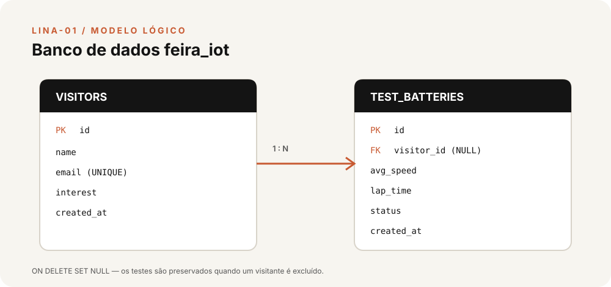

# Modelo lógico — LINA-01 / Feira Tecnológica

Banco de dados: `feira_iot`  
SGBD: MySQL 8.0 ou superior  
Mecanismo: InnoDB  
Codificação: `utf8mb4`

## Diagrama



## Entidades

### VISITORS
Armazena os visitantes que participam da experiência na Feira Tecnológica.

| Atributo | Tipo | Restrições | Descrição |
|---|---|---|---|
| `id` | INT UNSIGNED | PK, AUTO_INCREMENT | Identificador do visitante |
| `name` | VARCHAR(120) | NOT NULL | Nome completo |
| `email` | VARCHAR(150) | NOT NULL, UNIQUE | E-mail sem duplicidade |
| `interest` | VARCHAR(100) | NOT NULL | Área de interesse |
| `created_at` | DATETIME | NOT NULL, DEFAULT CURRENT_TIMESTAMP | Data e hora do cadastro |

### TEST_BATTERIES
Registra cada teste ou tentativa do robô seguidor de linha na pista.

| Atributo | Tipo | Restrições | Descrição |
|---|---|---|---|
| `id` | INT UNSIGNED | PK, AUTO_INCREMENT | Identificador do teste |
| `visitor_id` | INT UNSIGNED | FK, NULL | Visitante associado, quando informado |
| `avg_speed` | DECIMAL(5,2) | NOT NULL | Velocidade média em m/s |
| `lap_time` | DECIMAL(6,2) | NOT NULL | Tempo da volta em segundos |
| `status` | ENUM | NOT NULL, DEFAULT 'Concluído' | Situação do teste |
| `created_at` | DATETIME | NOT NULL, DEFAULT CURRENT_TIMESTAMP | Data e hora do teste |

## Relacionamento

- Um visitante pode estar associado a zero, uma ou várias baterias de teste.
- Cada bateria de teste pode estar associada a zero ou um visitante.
- Cardinalidade: `VISITORS (1) ---- (0..N) TEST_BATTERIES`.
- A chave estrangeira `test_batteries.visitor_id` referencia `visitors.id`.
- A regra `ON DELETE SET NULL` preserva os testes quando um visitante for excluído.

## Diagrama textual

```text
VISITORS
---------
PK id
   name
   email (UNIQUE)
   interest
   created_at
       |
       | 1 : N
       |
TEST_BATTERIES
--------------
PK id
FK visitor_id -> VISITORS.id (NULL permitido)
   avg_speed
   lap_time
   status
   created_at
```

## Normalização

- **1FN:** os atributos armazenam valores atômicos e não há grupos repetidos.
- **2FN:** as duas tabelas utilizam chave primária simples; os atributos não-chave dependem da chave inteira.
- **3FN:** os dados do visitante ficam em `visitors`; os dados de cada teste ficam em `test_batteries`. O nome e o e-mail do visitante não são repetidos na tabela de testes.

O script completo, com comentários, índices e restrições, está em `database/feira_iot.sql`.
